# Takenotes

**Tus notas, en papel.** Una app de notas **local-first**, open source y en español, con las funciones esenciales de Notion: editor de bloques, páginas anidadas, bases de datos con cuatro vistas, búsqueda a texto completo e importación desde Notion.

**Sin cuenta. Sin nube. Sin telemetría.** Todo se guarda en tu máquina.

**[Web](https://pureform132.github.io/takenotes/) · [Descargar para Windows](https://github.com/pureform132/takenotes/releases/latest) · [Demo en el navegador](https://pureform132.github.io/takenotes/app.html) · [Capturas](docs/screenshots/)**

[](LICENSE)
[](https://github.com/pureform132/takenotes/releases/latest)
[](#descargar)
[](#stack)

<p align="center">
  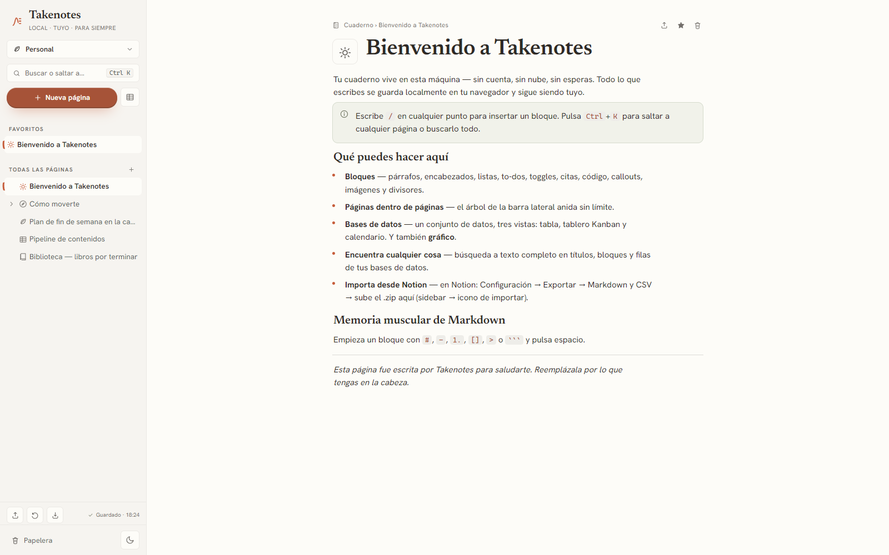
</p>

## Por qué existe

Notion es extraordinario, pero para muchas personas es demasiado: cuenta obligatoria, nube, planes que cambian, datos fuera de casa. **Takenotes** conserva lo que de verdad se usa a diario y lo reduce a un cuaderno cálido que abre al instante:

- **Tus notas viven en tu equipo** (IndexedDB en la app, `%APPDATA%\Takenotes` en Windows). Nada viaja a un servidor.
- **Gratis y libre**, licencia MIT: puedes leerlo, modificarlo, redistribuirlo y auditarlo.
- **En español**, pensado y escrito en español, no traducido a posteriori.
- **13 MB, no 350 MB**: ventana nativa sobre WebView2 en lugar de un navegador empaquetado.

> No es un clon de Notion. Replica sus *funciones* principales con una interfaz propia, y no incluye colaboración en tiempo real, IA ni publicaciones web.

## Capturas

| Editor y páginas anidadas | Bases de datos — tabla |
|---|---|
|  | 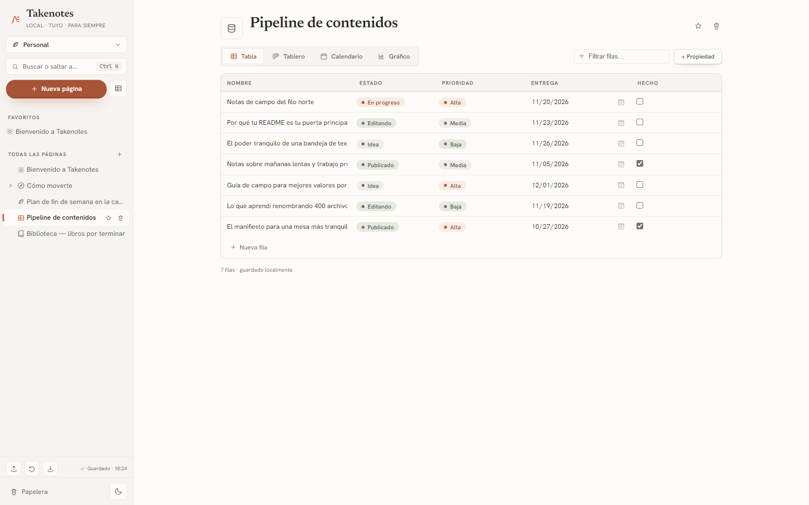 |

| Tablero Kanban | Gráfico de barras |
|---|---|
| 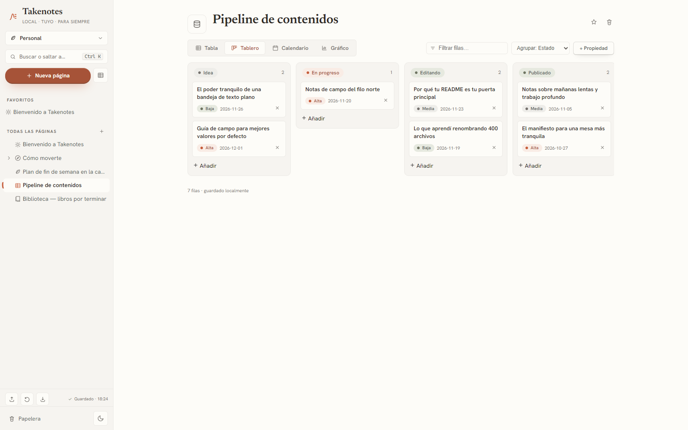 | 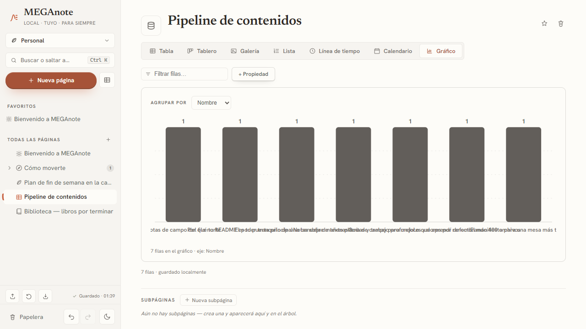 |

| Modo oscuro — The Night Desk | Búsqueda a texto completo (Ctrl+K) |
|---|---|
| 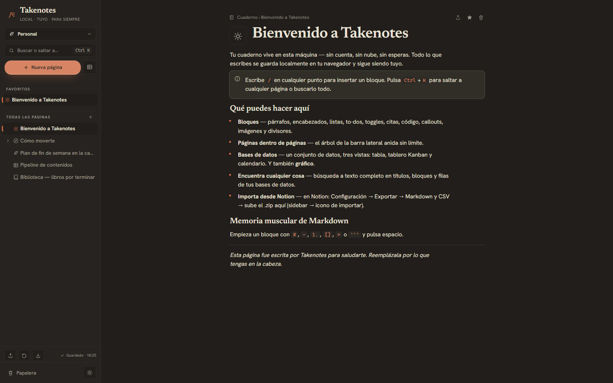 | 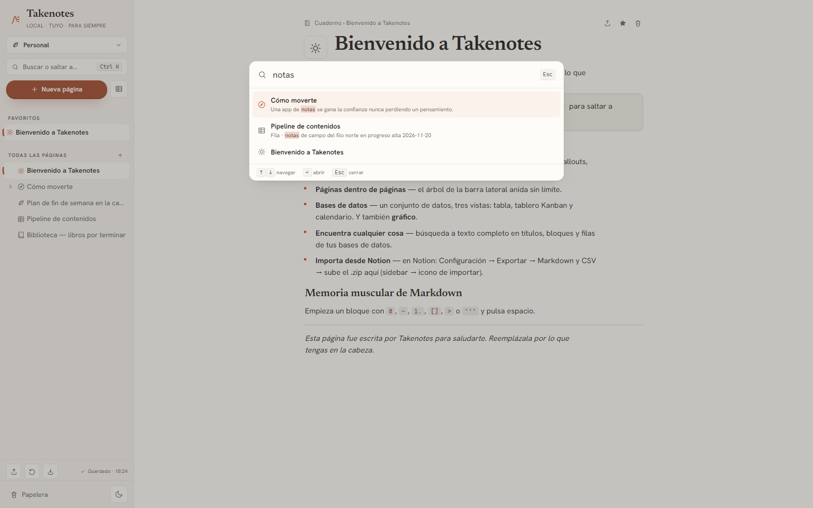 |

| Comandos con `/` | Importar desde Notion |
|---|---|
| 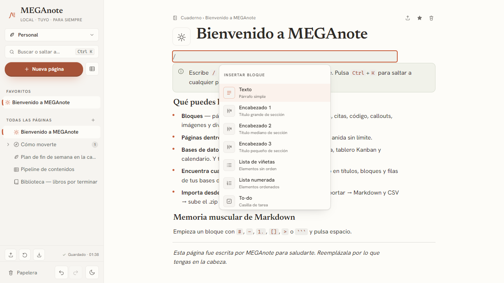 | 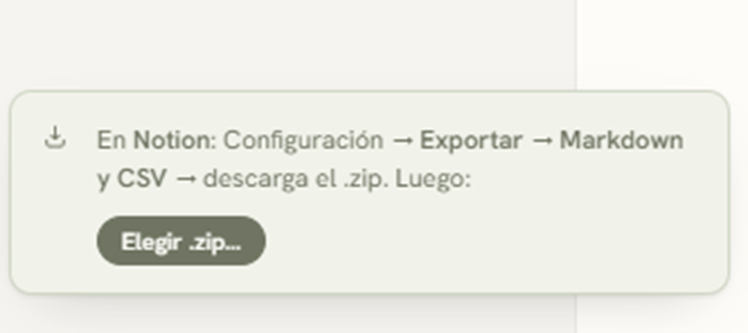 |

| Varios workspaces | Calendario |
|---|---|
| 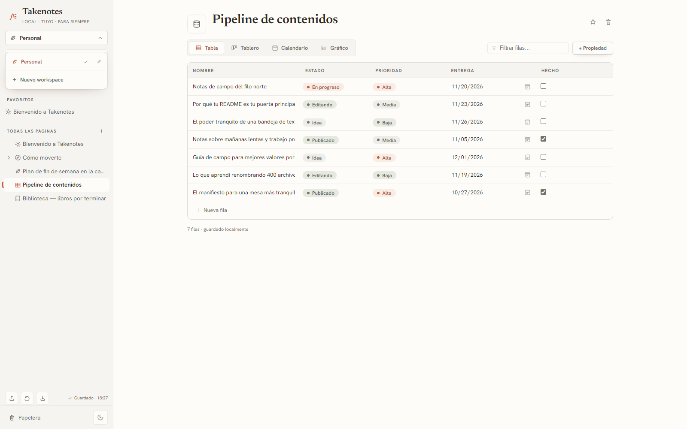 | 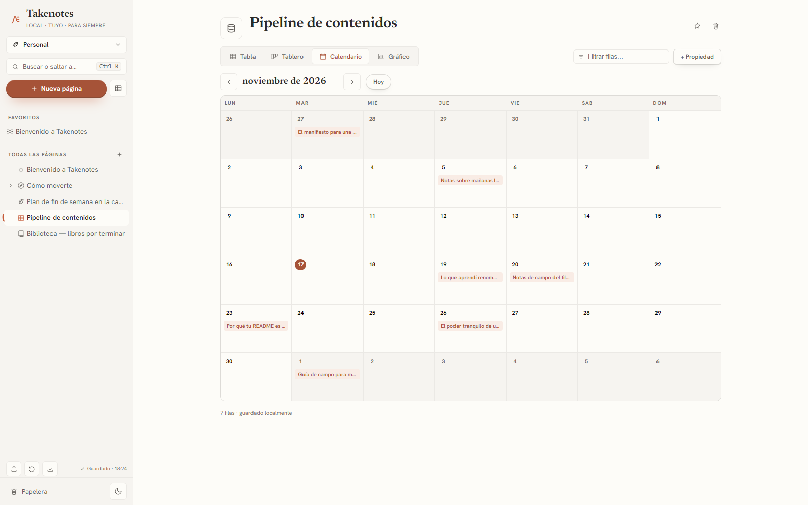 |

| Galería de base de datos | Gráfico donut |
|---|---|
| 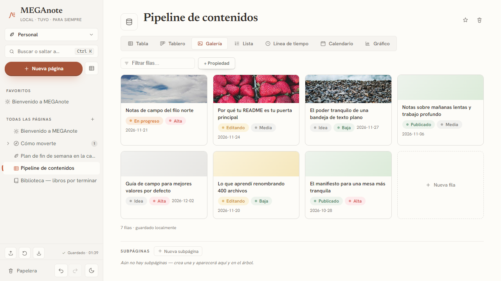 | 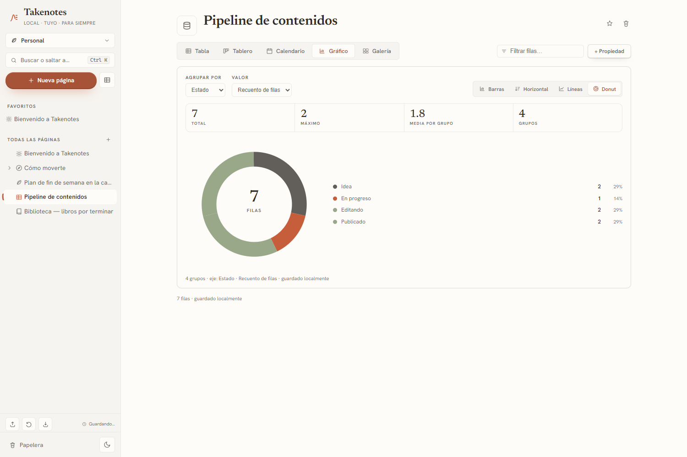 |

| 43 stickers para el encabezado | Tabla de contenido |
|---|---|
| 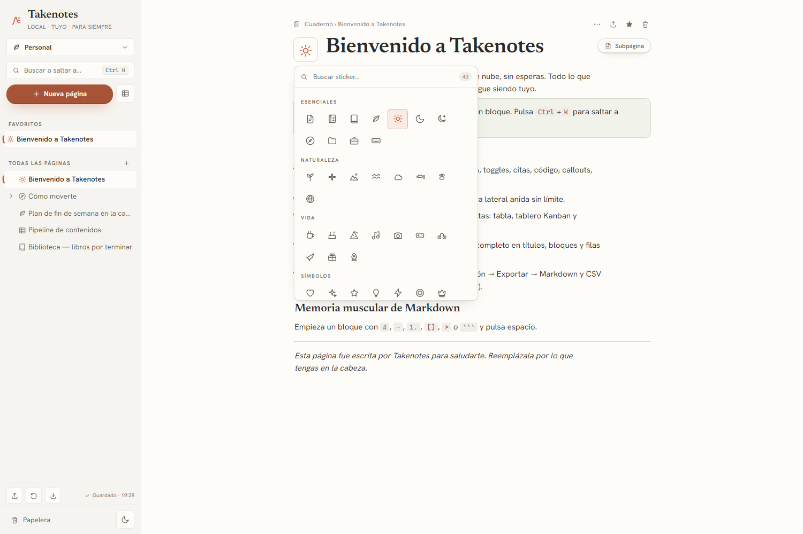 | 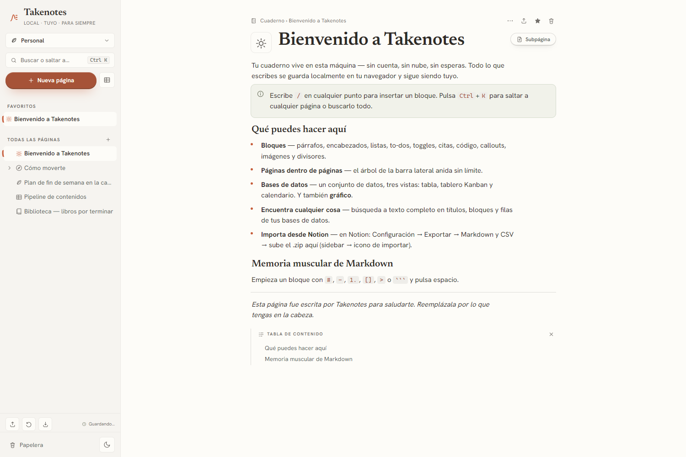 |

## Funciones

- **Editor de bloques** — texto, H1–H3, listas, to-dos, toggles, citas, código, destacados, divisores, imágenes y adjuntos de cualquier tipo.
- **Subpáginas** — crea una página dentro de otra desde el encabezado o con `/subpágina`; la tarjeta muestra su icono, título y número de hijas.
- **Stickers y portadas** — 43 iconos propios con buscador y seis portadas planas de la paleta.
- **Tabla de contenido** — `/toc` genera un índice navegable desde los encabezados H1–H3.
- **Duplicar y mover** — copia una página con todo su subárbol o muévela con un buscador de destinos.
- **Enlaces y backlinks** — menciona páginas con `/enlace` y descubre quién te menciona en «Mencionada en».
- **Menú `/`** — 17 tipos de bloque, navegable con teclado.
- **Formato inline** — `Ctrl+B` negrita, `Ctrl+I` itálica, `Ctrl+Shift+X` tachado, `Ctrl+\`` código.
- **Atajos Markdown** — `#`, `##`, `###`, `-`, `1.`, `[]`, `>`, ` ``` ` al inicio de un bloque.
- **Páginas dentro de páginas** — árbol sin límite, favoritos y papelera reversible.
- **Bases de datos** — texto, número, selección, fecha y casilla; cinco vistas: **tabla**, **kanban**, **calendario**, **galería** y **gráfico**.
- **Gráficos** — barras, horizontal, líneas/área y donut; agrupa por selección, fecha, casilla o texto y elige recuento, suma o media.
- **Búsqueda a texto completo** — `Ctrl/Cmd+K` sobre títulos, bloques y filas de bases de datos.
- **Varios workspaces** — cuadernos separados (Personal, Trabajo, …) con su propio árbol.
- **Importar desde Notion** — el export oficial **Markdown y CSV**: páginas, jerarquía, bases de datos e imágenes.
- **Modo oscuro** — «The Night Desk», los mismos cuatro matices invertidos.
- **Copias de seguridad** — JSON completo con restauración validada y exportación de cada página a Markdown.

## Takenotes frente a Notion

| | Takenotes | Notion |
|---|---|---|
| Cuenta | **No hace falta** | Obligatoria |
| Dónde viven tus datos | **Tu máquina** | Servidores de Notion |
| Precio | **Gratis (MIT)** | Freemium |
| Funciona sin internet | **Sí** | Limitado |
| Tamaño de la app de escritorio | **~13 MB** | Cientos de MB |
| Colaboración en tiempo real | No | Sí |
| IA / publicaciones web | No | Sí |

## Descargar

### Windows (recomendado)

1. Descarga **`Takenotes.exe`** desde [la última release](https://github.com/pureform132/takenotes/releases/latest).
2. Doble clic. No hay instalador: es un único ejecutable de ~13 MB sobre WebView2.
3. Tus notas se guardan en `%APPDATA%\Takenotes`.

> El ejecutable no está firmado con un certificado de pago, así que Windows SmartScreen puede avisar la primera vez: **Más información → Ejecutar de todas formas**. El código completo está aquí para auditarlo.

### Navegador, sin instalar nada

Abre **[la demo](https://pureform132.github.io/takenotes/app.html)**. Es el mismo build en un único archivo HTML autocontenido; los datos quedan en el IndexedDB de ese navegador.

### Desde el código

```bash
git clone https://github.com/pureform132/takenotes.git
cd takenotes
npm install
npm run dev      # desarrollo
npm run build    # build de producción en dist/
```

Para generar el ejecutable de Windows, mira [Recompilar la app de escritorio](#recompilar-la-app-de-escritorio).

## Importar tu workspace de Notion

1. En Notion: **Configuración → Exportar → Markdown y CSV** (incluye subpáginas y bases de datos) y descarga el `.zip`.
2. En Takenotes: icono de **importar** en el pie de la barra lateral.
3. **Elegir .zip…** — el importador reconstruye páginas, jerarquía, bloques, bases de datos CSV (con tipos inferidos) e imágenes relativas.

Límites honestos: las imágenes de hasta **1,5 MB** se incrustan; los adjuntos que no son imagen se conservan como referencia textual. Los bloques de Notion sin equivalente (p. ej. synced blocks o relaciones entre bases de datos) se degradan a texto.

## Tus datos son tuyos

- **Auto-guardado** con debounce de 350 ms e indicador «Guardado · HH:MM».
- **Copia JSON** y **restauración validada** desde la barra lateral.
- **Markdown por página** para llevarte cualquier texto a otra herramienta.
- **Cero peticiones de red en tiempo de ejecución**: fuentes e iconos van dentro del build. No hay analítica ni telemetría.

## Stack

React 19 · Vite 7 · TypeScript · IndexedDB · jszip + papaparse (importador) · PyInstaller + pywebview (escritorio). Sin backend.

```
src/
  App.tsx                  esqueleto: sidebar + lienzo + paleta + avisos
  state/WorkspaceContext   estado global, auto-guardado, backups, importación
  lib/
    types.ts               bloques, páginas, bases de datos, workspaces
    db.ts                  IndexedDB + migración v1→v2
    notionImport.ts        export Markdown y CSV de Notion → páginas y tablas
    export.ts              backup JSON + Markdown
    html.ts                sanitizador de HTML inline
    theme.ts               tema claro/oscuro
  components/              Sidebar, Editor, DatabaseView, SearchPalette...
  styles/app.css           sistema de diseño (4 matices + color-mix)
docs/                      landing page (GitHub Pages) y capturas
scripts/                   launcher de escritorio e iconos
```

## Recompilar la app de escritorio

```powershell
npm run build
python -m venv .venv-release
.venv-release\Scripts\pip install pywebview pyinstaller
.venv-release\Scripts\pyinstaller --onefile --noconsole --name Takenotes ^
  --icon scripts\icon.ico --add-data "dist;dist" --distpath release-py scripts\takenotes_app.py
```

El resultado queda en `release-py/Takenotes.exe`.

## Contribuir

Las contribuciones son bienvenidas: errores, traducciones, accesibilidad, nuevas vistas o mejoras del importador. Lee [CONTRIBUTING.md](CONTRIBUTING.md) y abre un issue antes de cambios grandes.

## Preguntas frecuentes

**¿Es realmente gratis?** Sí. MIT, sin plan de pago, sin registro y sin límites de páginas.

**¿Dónde se guardan mis notas?** En IndexedDB dentro de la app. En el ejecutable de Windows, en `%APPDATA%\Takenotes`. Puedes exportarlas cuando quieras.

**¿Funciona sin internet?** Sí, el 100 % de la app es local. Solo necesitas internet para descargarla.

**¿Puedo importar desde Notion?** Sí, con el export oficial Markdown y CSV. También acepta backups JSON de Takenotes.

**¿Hay versión para macOS o Linux?** El build web funciona en cualquier navegador moderno. El ejecutable de escritorio es Windows por ahora; el launcher de Python es multiplataforma y acepta PRs.

**¿Reemplaza a Notion?** Para notas personales, bases de datos y planificación, sí. Si necesitas colaboración en tiempo real o IA, no.

## Licencia

[MIT](LICENSE) © 2026 Takenotes contributors. Haz lo que quieras, conserva el aviso de copyright.
